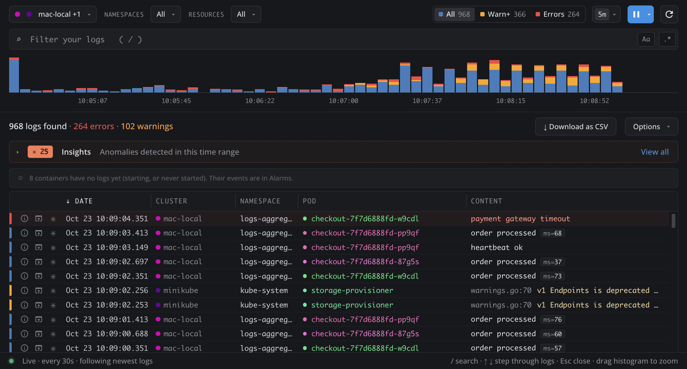
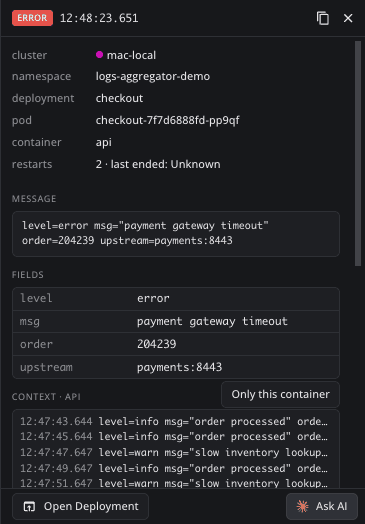
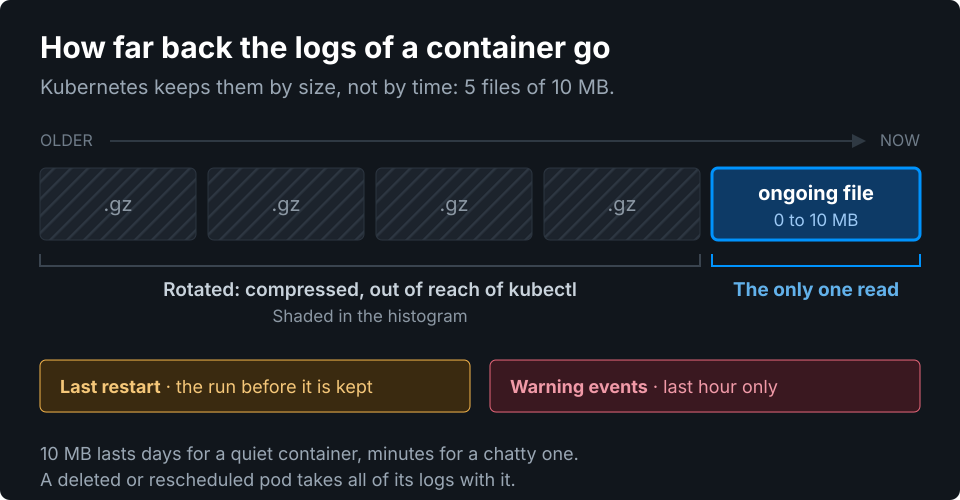
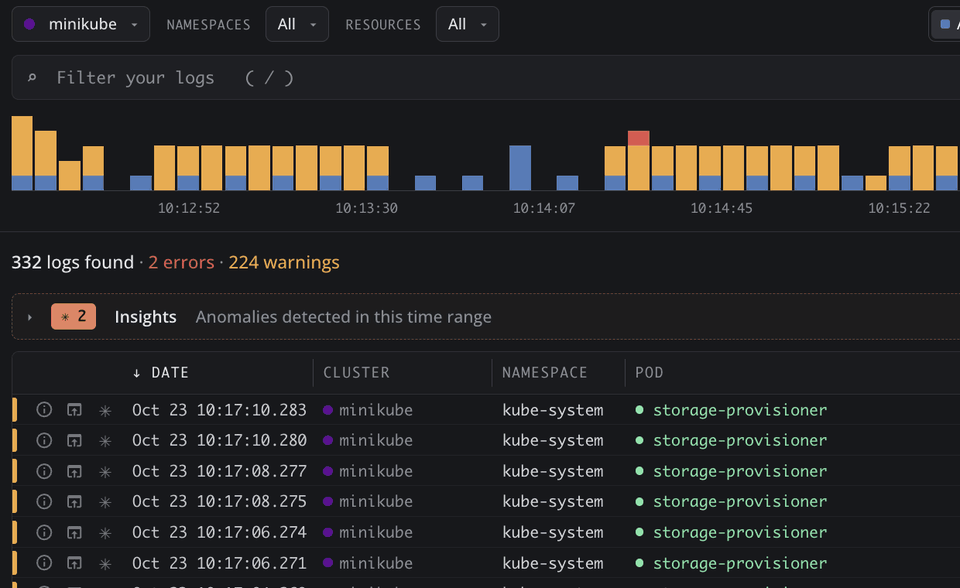
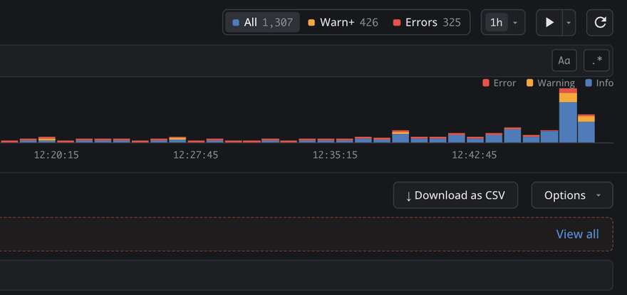
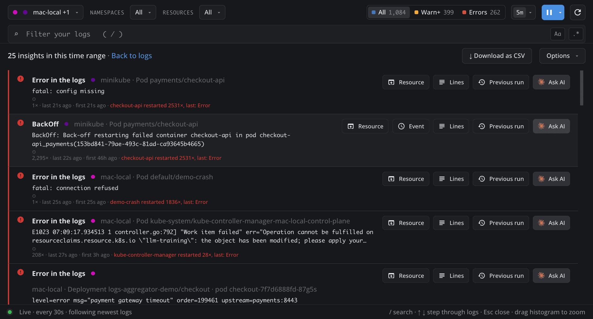
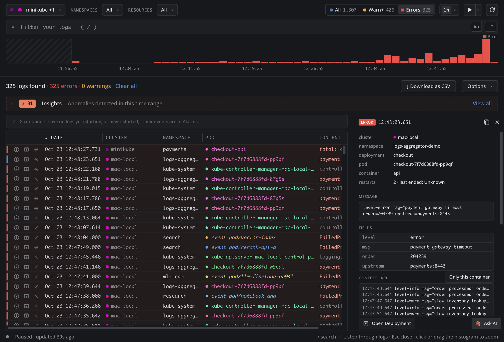
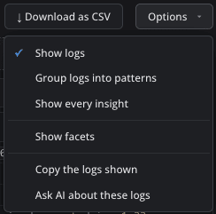
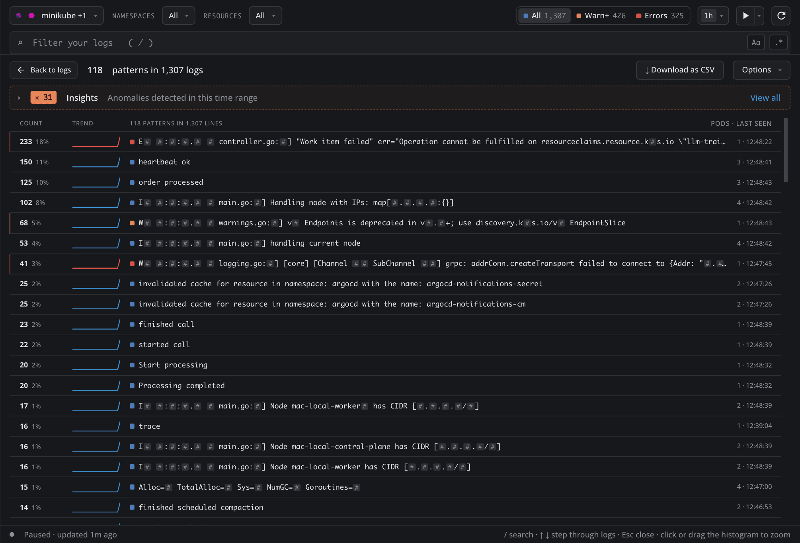

# Live Log Aggregation

The live logs and Warning events of all your clusters in one timeline, with the alarms first.

- **One timeline** of every pod and cluster you pick.
- **Alarms first:** crashes and errors, with Ask AI.
- **Nothing installed:** read live with `kubectl`.

**Found the problem? Act on it from the same place.** Every error line and every alarm says which cluster, namespace, workload, pod and container it comes from, and gives you two ways forward:

- **Open Deployment** (or the pod, statefulset, job or event behind it) takes you to that resource in Lens, to read its spec, restart it or edit it.
- **Ask AI** hands the line to the AI tool set up in Lens, with the pod's state and the lines around it, to find the root cause.

## What live means

Logs are read straight from the containers, the way `kubectl logs` reads them, while the tab is on screen. Nothing is copied, stored or sent anywhere.

- **What you get:** what each container has written lately, merged across pods and clusters, and kept up to date while **Live** is on.
- **What you do not get:** history kept elsewhere. Kubernetes keeps only the newest logs of each container, and a deleted pod takes its logs with it. For days or months of history, you need a logging stack such as Loki, Elastic or Datadog. Reading from one of them can be added on request.

Kubernetes keeps a container's logs by size, not by time. Live Log Aggregation reads the ongoing file, which holds up to 10 MB. The older files are compressed and out of reach of kubectl, so the histogram shades that stretch.

## Install

[Open Live Log Aggregation in Lens](https://app.k8slens.dev/lens-launcher?c=lens%3A%2F%2Fapp%2Fopen%2Fextension%3Fname%3Dlive-log-aggregation)

## Open it

- **From a workload or a pod:** right-click it in any list and pick **Aggregate logs**. The tab opens narrowed to it.
- **From the command palette:** run **Live Log Aggregation: Open** to read every connected cluster.

## Configuration

Everything is set in the top bar, left to right. Each choice is kept per tab.

1. **Select clusters.** Open **Clusters** and tick one or more. Type to find one by name. All connected clusters are read by default.

   

2. **Select namespaces and resources.** Narrow to the namespaces, workloads or pods you care about. Picking a workload or pod also reads further back.

3. **Select how often kubectl runs.** With **▶** on, the caret beside it sets the logs capture resolution: every 10s, 30s, 1m or 5m. A slower pace puts less load on the API server.

   

4. **Select the visibility window.** **5m ▾** sets how far back to show: 5m, 15m, 1h, 6h or 24h.

5. **Select the level.** **All / Warn+ / Errors** keeps every line, warnings and up, or errors only.

## See what is wrong first

**View all** in the Insights strip opens the alarms: errors and Warning events grouped by resource, with counts and restarts.

Each alarm opens its **Resource** or **Event** in Lens, shows its **Lines**, or hands it to **Ask AI**.

## Dig into a line

Click a line to see its cluster, pod and container, the message and its fields, and the lines around it.

Stack traces show as one line with a `+N lines` badge. Keys: `/` search, ↑ ↓ move, Esc close.

## Group lines into patterns

**Options ▾ › Group logs into patterns** turns hundreds of lines into one row per kind of message. Numbers that change from line to line show as `#`.

| Column | What it says |
|---|---|
| **Count** | How many lines follow the pattern, and their share of all lines. |
| **Trend** | How often it appeared across the time window, left to right. |
| **Pods · Last seen** | How many pods write it, and when it last appeared. |

Read the trend by its shape:

- **Rising at the right end:** it is happening more now. Look at these first.
- **Falling to the right:** it stopped. It was a burst, often a restart or a rollout.
- **Flat:** steady background noise, such as heartbeats or periodic warnings.
- **A single spike:** something happened once, at that moment.

The coloured square is the level, as in the histogram. Hover a row for a real line, and click it to see its lines in the timeline.

## Search

| Write | To keep |
|---|---|
| `timeout` `"connection refused"` | lines that say it |
| `-pod:api-*` | lines that do not match |
| `level:error` `ns:argocd` `cluster:prod` | a level, namespace or cluster |
| `@code:>=500` `@trace_id:*` | a field of JSON or logfmt lines |

Clauses are combined with AND. Every filter, wherever you set it (a row, the details, an alarm, a pattern), shows up here and in the facets. **Options ▾** adds facets, patterns, CSV download and Ask AI about the view.

## Load on your clusters

Logs are read with the kubectl and credentials Lens keeps for each cluster, only while the tab is on screen.

> **On a large or audited cluster,** narrow to the namespaces you need, slow Live to 1m or 5m, and pause it when done. Every read shows in the API server audit log under your user.

Limits: up to 5 clusters and 300 pods per cluster. Each container gives its newest 50 lines, 200 when narrowed, and 200 or 1,000 over 6h and 24h. Narrowed to a workload or pod over 6h or 24h, it gives up to 30,000, so a whole day usually shows. The histogram shades what was not read. What changed is in [CHANGELOG.md](./CHANGELOG.md).
